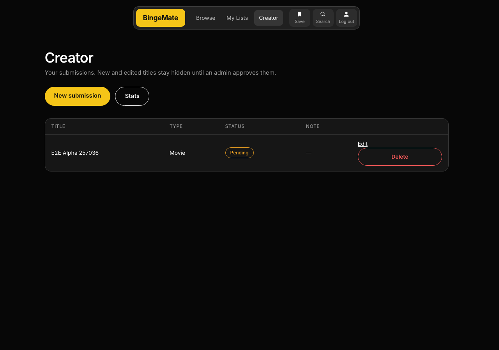
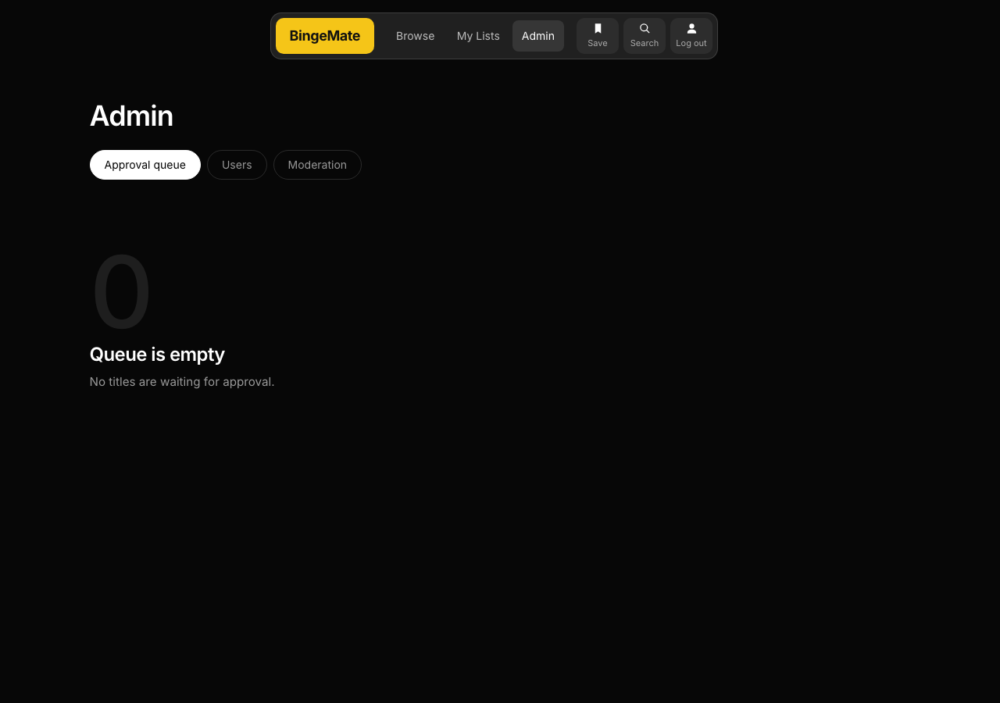
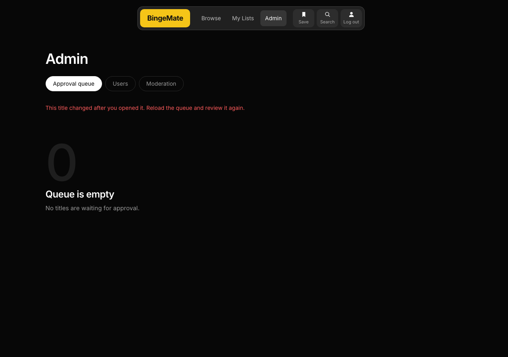
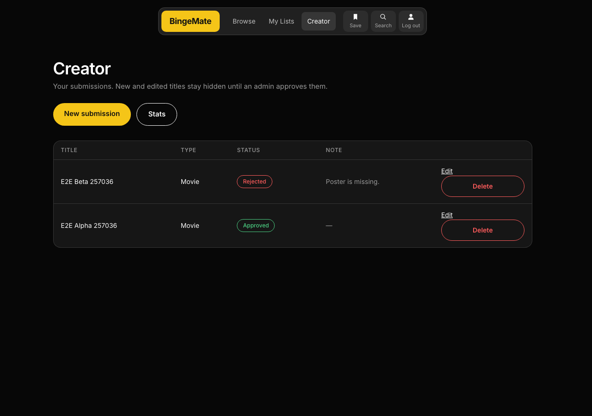
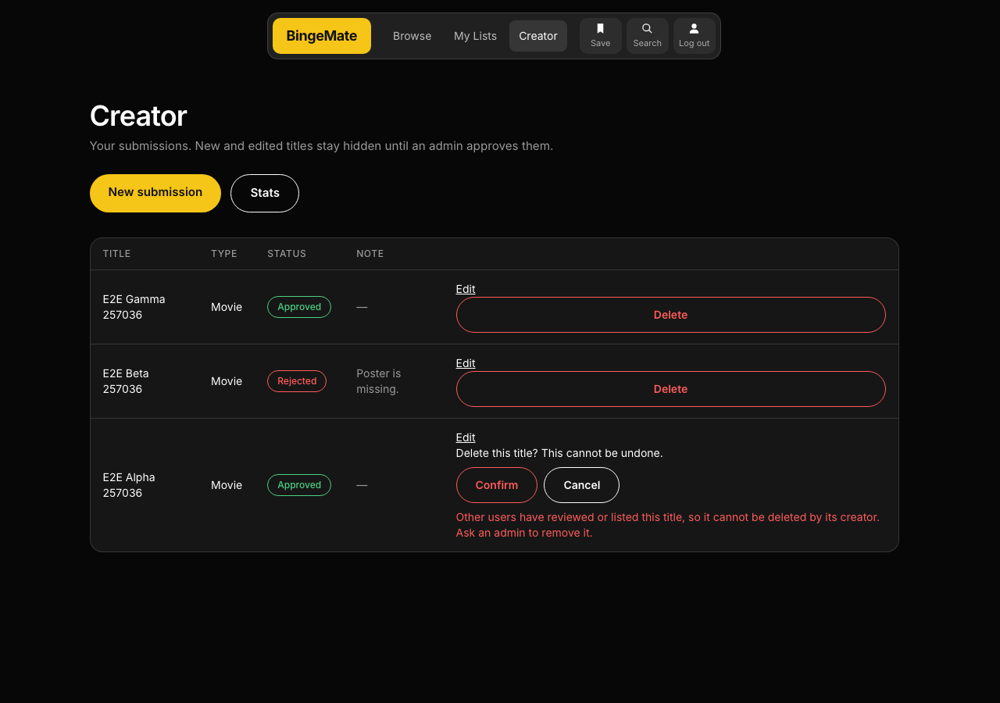
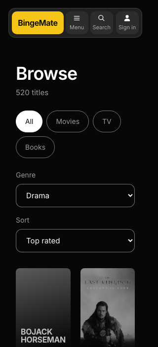

# Real-browser check: creator, admin and reader flows

Run on 3 Nov 2026 against the running dev stack: web on `http://localhost:5173` with `VITE_USE_MOCKS=false`, API on `http://localhost:4000`, the dev databases (1,500 titles, 13,491 reviews). A scripted Chromium (Playwright 1.49.1, headless, its own empty profile) drove three separate sessions: `creator@bingemate.dev`, `admin@bingemate.dev` and the imported reader `user4@seed.bingemate.local`. The scripts are `docs/e2e/click-through.mjs` and `docs/e2e/visual.mjs`.

**Result: 24 of 24 steps passed** (the first 23 on three complete runs, one of them from the committed copy; the 24th was added after the code review and passed on its own run and in the full run). **The visual check had 22 passes and no failures.** After every run the databases were back to exactly 1,500 titles, 13,491 reviews, 13,491 review bodies, 1 reply, 0 posters and no `E2E` rows: the script creates its own test titles and deletes them through the interface, so the deletes are part of what is tested.

## Steps

| #   | Role    | Step                                                                              | What it proves                                                                                          | Result |
| --- | ------- | --------------------------------------------------------------------------------- | ------------------------------------------------------------------------------------------------------- | ------ |
| 1   | Creator | Sign in                                                                           | Login works through the form and cookie                                                                 | Pass   |
| 2   | Creator | Open the Creator page                                                             | The page is headed "Creator" and says "Your submissions"                                                | Pass   |
| 3   | Creator | Submit a title with an image                                                      | Saved as PENDING; the upload succeeds; the owner gets the image back (HTTP 200)                         | Pass   |
| 4   | Visitor | Fetch the pending title and its image without signing in                          | Both answer 404, so nothing leaks                                                                       | Pass   |
| 5   | Creator | Edit the pending title                                                            | Saved; still PENDING                                                                                    | Pass   |
| 6   | Admin   | Sign in                                                                           | No Creator link in the header                                                                           | Pass   |
| 7   | Admin   | Open the approval queue and approve                                               | The title becomes public (HTTP 200)                                                                     | Pass   |
| 8   | Creator | Edit the approved title and re-submit                                             | Back to PENDING and hidden from the public                                                              | Pass   |
| 9   | Admin   | Approve it again                                                                  | Public again                                                                                            | Pass   |
| 10  | Admin   | Reject a second title with a typed reason                                         | Status REJECTED and the reason stored                                                                   | Pass   |
| 11  | Creator | Look at the Creator page                                                          | The rejection reason shows in the Note column                                                           | Pass   |
| 12  | Admin   | Open the same pending title in two tabs, approve in one, then reject in the other | The second tab shows "This title changed after you opened it": the `updatedAt` version check            | Pass   |
| 13  | Reader  | Sign in                                                                           | Login as an imported user                                                                               | Pass   |
| 14  | Reader  | Open the approved title                                                           | Public page with the uploaded image                                                                     | Pass   |
| 15  | Reader  | Write a review: 4 stars and text                                                  | The POST answers 201 and `reviews/mine` returns rating 4                                                | Pass   |
| 16  | Reader  | Edit the review                                                                   | New text shown                                                                                          | Pass   |
| 17  | Reader  | Reply to the review                                                               | The reply shows under it                                                                                | Pass   |
| 18  | Reader  | Add to My Lists as Completed, open My Lists, remove it (confirm in the dialog)    | Entry appears, then is gone                                                                             | Pass   |
| 19  | Creator | Try to delete the title while another user has reviewed and listed it             | Refused with "Other users have reviewed or listed this title ... ask an admin"                          | Pass   |
| 20  | Reader  | Delete their own review (confirm in the dialog)                                   | The DELETE answers 200 or 204 and `reviews/mine` is empty                                               | Pass   |
| 21  | Creator | Delete the approved title                                                         | Gone from the dashboard                                                                                 | Pass   |
| 22  | Creator | Delete the rejected title                                                         | Gone                                                                                                    | Pass   |
| 23  | Creator | Delete the third (approved in the two-tab test) title                             | Gone                                                                                                    | Pass   |
| 24  | Creator | Force the image upload to fail (HTTP 413) while submitting a new title            | Lands on the dashboard with a one-time notice; exactly one title exists, so a retry cannot duplicate it | Pass   |

## Also checked

- **Home** requests `/api/trending` (the strip reads the trending API) at 1280 px and 320 px, with no horizontal overflow.
- **Browse** requests `/api/genres`, lists real genres (Drama, Comedy, Thriller, Crime, ...), sends `genre=Drama&sort=rating&page=1` when you change the selects, keeps `sort` in the URL, and has no horizontal overflow at 320 px.
- **Console:** no errors apart from two expected kinds. The anonymous session check answers 401 when nobody is signed in, and some imported titles point at dead external poster links (404); the card falls back to its gradient.

## Screenshots








## What this did not cover

- Registration, the creator stats page, status changes from the My Lists dropdown, search suggestions, replacing or removing an image, uploads that are too big or the wrong type.
- Keyboard-only use and screen readers. The review form and the admin reason box do have accessible names (for example "Reason for <title>"), but nobody has tried them with assistive technology.
- Any browser except headless Chromium; no Safari or Firefox.
- Phone layout of the creator and admin screens (only Home and Browse were measured at 320 px).
- Admin user and role management and review moderation: they are not built (`TASKS.md` section 4).
- Load or concurrency from the browser. Concurrency is covered by the real-database tests.

## Notes for the team

- Both the login and registration routes are limited to 20 requests per 15 minutes per IP. A run uses three logins, so wait before re-running many times; the script now says "login rate limited (429)" instead of timing out.
- `jobs/cleanupOrphans.ts` removes orphaned review bodies and replies but not poster documents. If a title row is deleted outside the application (for example by hand in SQL), its poster document stays. The application's own delete removes it, as steps 21 to 23 show.
- A wrong guess about a screen label cost a few attempts while writing the script (for example the reason box is named "Reason for <title>" and the Creator page is headed "Creator"). None was an application defect. The user manual had two of those wording errors and was corrected.

## Re-run it

```
# Playwright is not a project dependency: install it without touching package.json
npm install --no-save playwright@1.49.1
npx playwright install chromium

docker compose up -d
# start the API (npm run dev:api) and the web app with VITE_USE_MOCKS=false (npm run dev:web)

node docs/e2e/click-through.mjs     # creator, admin and reader flows; deletes what it creates
node docs/e2e/visual.mjs            # Home and Browse at 1280 px and 320 px
```

Output (screenshots and `results.json`) goes to `$E2E_OUT`, or `bingemate-e2e` in the system temp folder. The scripts use the demo accounts and the imported reader from the README, so run them on the loaded dataset. If your Playwright download installs a different browser build, point `CHROMIUM_PATH` at the browser binary.
